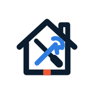

<p align="center">
  
</p>

<h1 align="center">Renova</h1>
<p align="center"><b>Todo lo que tu hogar necesita a un clic.</b><br/>
Técnicos verificados · Precio claro · Hora exacta · Garantía de 30 días</p>

---

Piloto web (PWA, pensado para celular) de **Renova**, una app para contratar servicios del hogar en Bogotá y comprar materiales en ferreterías aliadas. Esta primera versión se enfoca en la **experiencia del cliente**.

**Demo en vivo:** _pendiente — se agrega al conectar Vercel ([cómo](docs/05-git-y-despliegue.md#despliegue-en-vercel))_

## 👋 Si acabas de llegar al proyecto

1. Lee este README (2 min).
2. Lee **[Fases, roles y tareas](docs/02-fases-y-roles.md)** → ahí está **tu rol** y **qué debes hacer**.
3. Corre el proyecto (abajo) y ábrelo en tu celular.
4. Toma la primera tarea de tu rol, crea tu rama y empieza. Si usas Claude Code, cada tarea trae un prompt listo.

## Roles

| Rol               | Enfoque                                                                  | Tareas | Quién                       |
| ----------------- | ------------------------------------------------------------------------ | ------ | --------------------------- |
| **A · Contratar** | Descubrir servicios, perfil del técnico, **flujo de reserva**, tienda    | A1–A8  | @NicoGomez4262 _(sugerido)_ |
| **B · Acompañar** | Mis reservas, **seguimiento en vivo**, chat, calificar, garantía, perfil | B1–B9  | Compañero/a                 |

## Estado

| Fase                             | Rol A                                     | Rol B                                                           |
| -------------------------------- | ----------------------------------------- | --------------------------------------------------------------- |
| **0 · Esqueleto**                | ✅ Proyecto, diseño, rutas, datos, Inicio | ✅                                                              |
| **1 · Núcleo**                   | ☐ A1 Catálogo · ☐ A2 Perfil del técnico   | ☐ B1 Mis reservas · ☐ B2 Detalle de reserva                     |
| **2 · Reserva de punta a punta** | ☐ A3 + A4 Flujo de reserva                | ☐ B3 Mensajes · ☐ B4 Calificar y garantía · ☐ B5 Notificaciones |
| **3 · Tienda y cuenta**          | ☐ A5 Tienda · ☐ A6 Carrito y checkout     | ☐ B6 Perfil e ingreso · ☐ B7 Bienvenida y Únete                 |
| **4 · Pulido y QA**              | ☐ A7                                      | ☐ B8                                                            |
| **5 · Auth real** _(opcional)_   | ☐ A8                                      | ☐ B9                                                            |

> Marquen ☐ → ✅ en el mismo PR que integra la tarea.

## Correr el proyecto

Requisitos: **Node.js 20+** y Git.

```bash
git clone https://github.com/NicoGomez4262/renova.git
cd renova
npm install
npm run dev        # abre la URL "Network" en tu celular (misma Wi-Fi)
```

| Comando                             | Para qué                                                |
| ----------------------------------- | ------------------------------------------------------- |
| `npm run dev`                       | Desarrollo local                                        |
| `npm run check`                     | Lint + tipos + build — **obligatorio antes de cada PR** |
| `npm run build` · `npm run preview` | Build de producción (con PWA)                           |

## Documentación

| Documento                                              | Contenido                                                                          |
| ------------------------------------------------------ | ---------------------------------------------------------------------------------- |
| [01 · Producto](docs/01-producto.md)                   | Qué es Renova, problema, pilares, alcance, mapa de pantallas, **guion de la demo** |
| [02 · Fases, roles y tareas](docs/02-fases-y-roles.md) | **Plan de trabajo**: línea de tiempo, reglas, tareas con criterios y prompts       |
| [03 · Diseño](docs/03-diseno.md)                       | Colores, tipografía, componentes y patrones de pantalla                            |
| [04 · Arquitectura](docs/04-arquitectura.md)           | Stack, carpetas, datos, ciclo de vida de la reserva, archivos compartidos          |
| [05 · Git y despliegue](docs/05-git-y-despliegue.md)   | Ramas, PRs, conflictos, Vercel, instalar en el celular                             |
| [CLAUDE.md](CLAUDE.md)                                 | Reglas para asistentes de IA (Claude Code)                                         |

## Stack

React 19 · TypeScript · Vite 7 · Tailwind CSS v4 · React Router 7 · Zustand · PWA · Vercel

---

<sub>Proyecto académico de emprendimiento · Pontificia Universidad Javeriana · Bogotá, 2026</sub>
